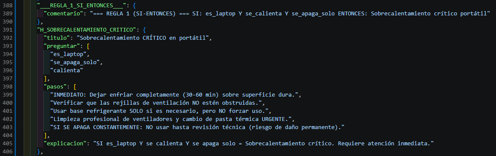
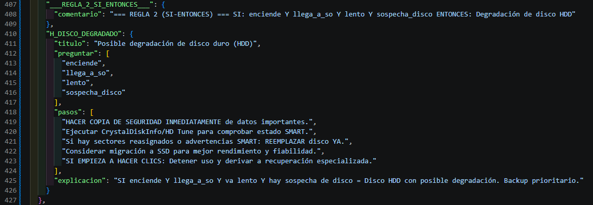

# **TechSupp**

## Problema que resuelve

**TechSupp** es un sistema experto de diagnóstico conversacional para guiar a usuarios no técnicos en la resolución de problemas básicos de PCs y portátiles. Detecta fallos como equipo que no enciende, pantalla negra, sobrecalentamiento, lentitud, problemas de WiFi/audio, entre otros, proporcionando un diagnóstico orientativo con pasos prácticos.

## ¿Cómo se ejecuta?

1. Instalar dependencias:
```bash
pip install rich
```

2. Ejecutar la aplicación:
```bash
python main.py
```

3. Seguir el menú numérico en consola para iniciar el diagnóstico.

## REGLAS AGREGADAS EN EL PARCIAL 2

Se agregaron dos nuevas reglas **SI-ENTONCES** al sistema experto:

### Regla 1: Sobrecalentamiento crítico en portátil

**SI:** Es un portátil **Y** se calienta **Y** se apaga solo  
**ENTONCES:** Diagnóstico `H_SOBRECALENTAMIENTO_CRITICO` - Sobrecalentamiento CRÍTICO en portátil



### Regla 2: Posible degradación de disco duro

**SI:** Enciende **Y** llega al Sistema Operativo **Y** va lento **Y** hay sospecha de disco  
**ENTONCES:** Diagnóstico `H_DISCO_DEGRADADO` - Posible degradación de disco duro (HDD)


